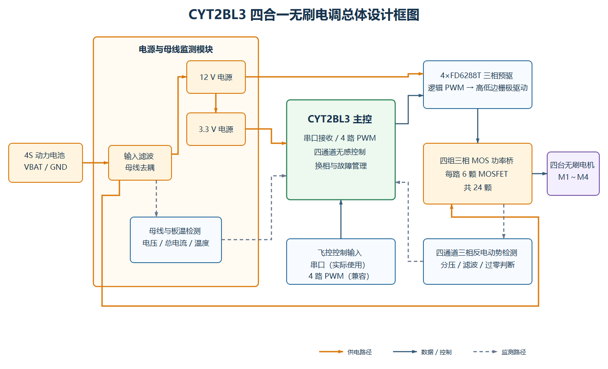
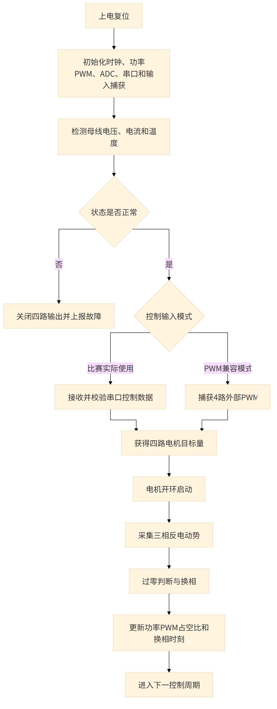
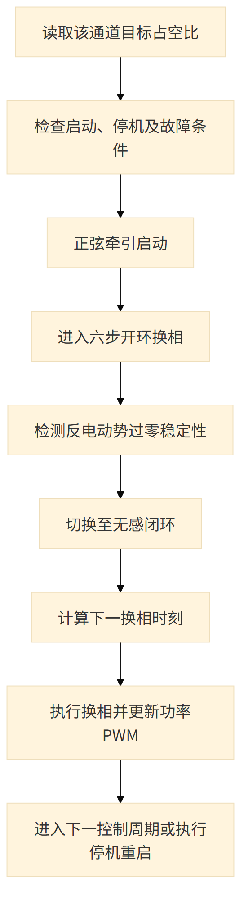
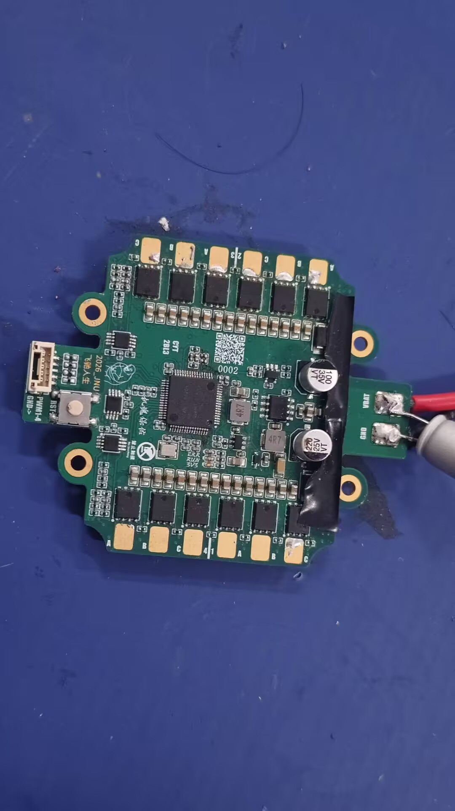
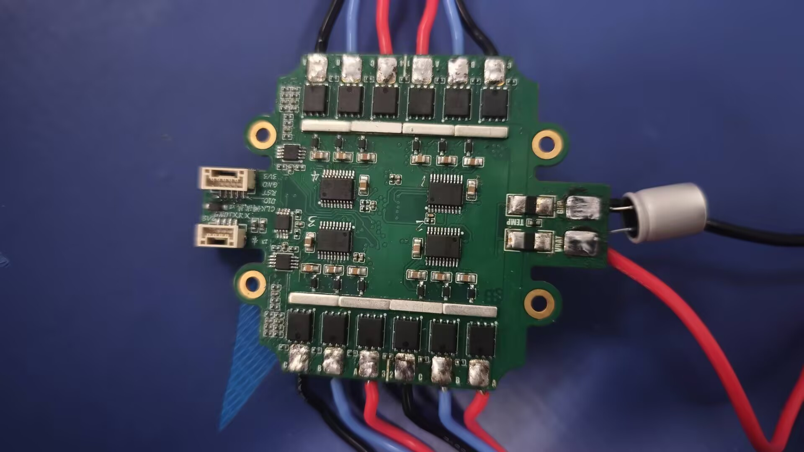
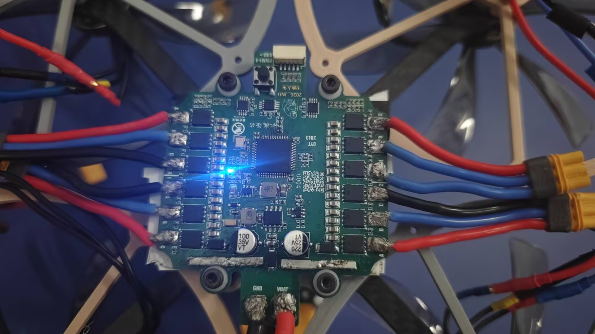

# 21届智能车_飞跃雷区_CYT2BL3四合一无刷电调

> 江南大学｜博世·飞驰人生队｜第21届全国大学生智能汽车竞赛“飞跃雷区”组

## 一、基础信息

### 1.1 团队介绍

| 项目 | 内容 |
| --- | --- |
| 学校 | 江南大学 |
| 队伍 | 博世·飞驰人生队 |
| 指导教师 | 吴定会、王建华 |
| 组别 | 飞跃雷区 |
| 参赛成员及分工 | 田进：控制、机械<br>何昱岷：控制、视觉<br>玄嘉澍：控制、视觉<br>谢欣冉：硬件<br>叶泽华：硬件、机械 |
| 团队经历与成绩 | 田进获第20届智能车竞赛全国二等奖，并担任 RoboMaster（RM）团队核心成员；其余成员均为首次参加智能车竞赛。团队在本届校赛中取得优异成绩，最终获华东赛区飞跃雷区组第五名、一等奖（以现有比赛成绩及获奖截图为依据） |

团队围绕无人机与地面小车协同系统完成控制、感知、动力和机械结构设计。本工程由队伍完成方案适配、PCB 设计、器件选型、焊接调试及整机验证。

### 1.2 题目要求

比赛场地为边长约 **5 m～7 m** 的平整区域，同一时刻可能有 **1～5 个**红光/红外信标点亮。比赛前可遥控悬停飞机起飞；飞机稳定悬停并示意发车后，第一个信标点亮并开始计时，此后选手不得再操作遥控器。机载摄像头和环境传感器识别信标并通过有线通信引导车模，车模驶过灯罩使信标熄灭，最后一个信标熄灭后停止计时，再由选手手动降落飞机。

车模与飞机通过不超过 **1.5 m** 的线缆供电和传输数据，两者之间禁止无线通信；信标感知设备必须安装在飞机上。车模及附属物应能放入 **30 cm×30 cm** 方框且高度小于 **30 cm**；飞机连同螺旋桨和保护罩应能放入 **50 cm×50 cm** 方框，最高点距地面不超过 **1.5 m**。目标搜索、图像处理和车模控制使用 **TRAVEO** 系列任务芯片；飞控、电调及关键电源/驱动电路需要自行设计，螺旋桨必须安装全包围保护罩。

> 规则依据：[车模与场地说明](https://blog.csdn.net/zhuoqingjoking97298/article/details/154691546)、[飞跃雷区问答](https://blog.csdn.net/zhuoqingjoking97298/article/details/157686655)。最终以现场组委会公布和检查结果为准。

## 二、设计概述

### 2.1 项目介绍

本项目是一块面向“飞跃雷区”四旋翼无人机的四合一无刷电机电子调速器。电路以英飞凌 CYT2BL3 系列微控制器为控制核心，在单块 PCB 上集成四路三相栅极预驱、24 颗功率 MOSFET、电机反电动势检测，以及母线电压、总电流和温度检测。比赛最终通过串口接收飞控发送的四路电机控制量，同时保留 4 路 PWM 兼容控制方式。相比四块独立电调，该方案减少线束和安装空间，并统一了检测、调试和供电设计。

## 三、核心设计

### 3.1 总体设计框图



4S 动力电池输入经滤波后分别进入功率母线和板载电源。CYT2BL3 主控在实际比赛中通过串口接收飞控发送的四路电机目标量，也可使用 4 路 PWM 兼容输入；主控据此控制四组三相预驱和 MOS 功率桥。电压、电流、温度及反电动势检测信号反馈给主控，用于换相、状态监测和保护。

### 3.2 硬件电路组成

#### 3.2.1 开源参考与二次设计

本工程基于逐飞科技开源的 [CYT2BL3 四合一无刷驱动工程](https://gitee.com/seekfree/CYT2BL3_Brushless_Driver_4IN1_Project) 进行适配设计，保留原工程的四合一总体架构，以及主控、电源、三相预驱、MOSFET 功率桥和检测等核心电路。队伍结合本项目的装配与线束需求，精简了未使用的外部接口，将原有接口焊盘调整为 **GH1.25 连接器**，并将封装较难手工焊接和返修的 **FD6288Q** 栅极预驱器替换为 **FD6288T**。上述修改主要用于提高接线可靠性、装配一致性以及人工焊接和返修的便利性，不改变原方案的四路无刷电机驱动功能。

> **开源来源与二次设计声明**
>
> **本工程属于对逐飞开源硬件的二次设计，并非由单路电调扩展得到的原创四合一架构。**参考工程及来源已在上文列明；复刻、修改和再发布时，**应同时保留该来源说明，并遵循原项目页面公布的开源许可要求。**

#### 3.2.2 主控、时钟与调试电路

主控电路包含 CYT2BL3 系列 MCU、16 MHz 晶振、复位按键、状态指示灯、飞控通信串口及调试连接器。主控通过串口接收包含四路目标量的控制数据，同时支持 4 路外部 PWM 输入；内部再输出四组三相 PWM 驱动预驱器，并采集换相、电源和温度检测信号。在 PCB 布局中，电调大电流的回流路径和内部模拟、数字信号进行了良好的隔离。


#### 3.2.3 电源输入与板载电源

动力电池从 VBAT/GND 焊盘进入，输入端使用多颗并联陶瓷电容抑制换相纹波。板上生成预驱所需 12 V 电源和 MCU 所需 3.3 V 电源。电池电压经分压送入 ADC，总电流经采样和运算放大后送入主控。


#### 3.2.4 三相功率桥与反电动势检测

每路电机使用三组半桥，共六颗功率 MOSFET；四个通道共 24 颗。三相中点连接电机接口，同时经分压和滤波形成反电动势检测信号，为无位置传感器换相提供依据。


#### 3.2.5 MOS 栅极预驱

四颗 **FD6288T** 集成三相预驱器把 MCU 输出的逻辑 PWM 转换为高、低边 MOSFET 栅极驱动信号。相较参考工程采用的 FD6288Q，T 型封装更便于队伍进行手工焊接、检查和返修。自举电容和二极管为高边驱动提供浮动电源。调试时必须确认互补 PWM 死区，避免同一桥臂上下管直通。


本工程未直接使用成品电调板，属于基于逐飞开源硬件与固件的二次设计；固件来源、继承内容和本队适配范围见 3.4 节。

### 3.3 项目功能与参数

核心功能：

- 通过串口接收飞控发送的四路电机控制量，这是比赛最终采用的控制方式。
- 兼容 4 路独立 PWM 电机控制输入，便于调试或替代接入。
- 独立驱动 4 台三相无刷电机。
- 检测各相反电动势，为无位置传感器换相提供依据。
- 检测电池母线电压、总电流和板上温度。
- 提供串口/调试接口、复位按键和状态指示灯。
- 生成 12 V、3.3 V 等板载电源。

关键参数：

| 参数 | 设计值/说明 |
| --- | --- |
| 电机通道 | 4 路三相无刷电机 |
| 控制输入 | 串口通信（最终使用），兼容 4 路独立 PWM 输入 |
| 功率器件 | 每路 6 颗 MOSFET，共 24 颗 |
| 栅极驱动 | 4×FD6288T 三相栅极预驱器 |
| 外部连接 | 精简接口，相关焊盘改用 GH1.25 连接器 |
| 检测量 | 母线电压、总电流、温度、各相反电动势 |
| 板载电源 | 12 V、3.3 V |
| PCB 层数 | 6 层（Gerber 含 4 个内层） |
| 输入与已验证负载 | 使用 4S 动力电池；整机电流达到 20 A 时未发现明显异常，更高负载尚未测试，20 A 不代表最大额定电流 |

### 3.4 程序设计流程图

#### 主程序流程



#### 单通道无感控制关键流程



#### 源代码功能与开源来源

固件主循环根据控制模式选择串口控制或四路 PWM 兼容输入，核心入口如下：

```c
if(motor_data[0].control_mode == 0)
{
    motor_driver_control_force_refresh(&communication_value);
}
else
{
    pwm_capture_callback();
}
```

电调固件基于逐飞科技开源的 [CYT2BL3 四合一无刷驱动工程](https://gitee.com/seekfree/CYT2BL3_Brushless_Driver_4IN1_Project) 修改，沿用原工程的四路无感无刷电机控制框架，包括飞控指令接收、电机启动、反电动势检测、换相和 PWM 调速等核心流程。本队结合实际板卡精简了不使用的外部接口，并对固件中的接口相关配置作相应适配。最终比赛版本采用串口传输四路电机控制量，同时保留 4 路 PWM 输入处理能力。

由于本项目所用电机的 KV 值与逐飞参考方案不同，原固件中的启动和保护参数不能直接照搬。为适配实际电机，本队将开环启动正弦牵引占空比由 **15% 降至 12%**，将堵转换相超时由 **50 ms 放宽至 125 ms**，并关闭了采用固定转速下降阈值的 `MOTOR_DISTURB_PROTECT` 转速突降干扰保护，避免该保护在本项目电机和桨叶负载下误触发并导致电机停机重启。复刻时应根据实际电机 KV 值、桨叶负载和供电电压重新调试上述参数。

本项目将原接口焊盘改为 GH1.25 连接器，并将 FD6288Q 替换为更便于焊接和返修的 FD6288T；这两项主要属于连接器和预驱器封装层面的硬件修改，不改变原固件的无感换相算法与四路控制原理。复刻或继续修改固件时，应保留上述逐飞工程来源，并遵循原项目页面公布的开源许可要求。

## 四、作品展示

### 4.1 实物展示



图6：CYT2BL3 四合一电调焊接完成整体实物，展示板卡外观及主要器件布局。



图7：MOSFET、FD6288T 预驱及 GH1.25 接口模块特写。



图8：CYT2BL3 四合一电调安装在无人机上的通电工作状态。

### 4.2 演示视频

视频附件：[江南大学-飞跃雷区-博世·飞驰人生队演示视频](../江南大学-飞跃雷区-博世·飞驰人生队-50MB内.mp4)

- 视频时长：约 1 分 45 秒。
- 核心内容：飞跃雷区整机比赛任务运行演示。
- 视频文件约 42 MiB，可直接作为开源报告附件上传。

## 五、补充说明

### 5.1 注意事项

- 首次上电必须使用限流电源，先不接电机检查 12 V、3.3 V 和栅极驱动电源。
- 焊接后应检查功率母线、桥臂和电机相线是否存在虚焊、连锡或短路。
- 首次驱动应降低母线电压，用示波器确认死区和高低边栅极波形。
- 输入电容具有较大充电冲击，接电池前必须确认极性并采取防短路措施。
- 最大电压、电流和散热能力必须以器件额定值和实测温升为准。
- 推荐装配顺序：小封装阻容/主控/预驱器→MOSFET→连接器→限流上电→单电机测试→四路带载测试。

#### 常见问题排查

1. 板上元器件较多且间距紧凑，焊锡碎屑或多股导线脱落的细金属丝落入器件间隙后容易造成短路。每次焊接、返修和装机后均应在断电并确认母线电容完成放电的情况下，使用放大镜检查和清洁 PCB，再进行限流上电。
2. 功率 MOSFET 烧毁时，所连接的栅极预驱器往往也可能损坏，维修时不能只更换 MOSFET，还应检查对应 FD6288T 的供电和输出。MCU 不直接驱动 MOSFET 栅极，预驱级能够起到一定的缓冲保护作用，因此 MCU 通常不会同时损坏；但重新上电前仍需检查 MCU 电源和相关控制引脚是否异常。
3. 在供电、焊接和电机接线均确认正常的情况下，若电调自检提示音异常，应优先检查对应通道的预驱器及自举电容。若这些部分正常，可继续检查栅极电阻和反电动势分压电阻；后两项是可参考的扩展排查方向，本队调试中暂未遇到相关故障。
4. GH1.25 连接器焊接牢固后若直接拉扯线束，仍可能将连接器连同 PCB 焊盘一起扯落。插拔时应握住连接器外壳操作，并对线束进行固定和应力释放，避免焊盘直接承受拉力。

### 5.2 附件内容

| 附件 | 文件名 | 内容 | 开源链接 |
| --- | --- | --- | --- |
| 附件一 | `2026_JNU_飞驰人生_四合一电调_2026-06-04.zip` | Gerber、钻孔及生产文件 | [下载生产文件](./2026_JNU_飞驰人生_四合一电调_2026-06-04.zip) |
| 附件二 | `BOM_Board1_V1.1_2026-06-04.xlsx` | 物料清单 | [下载 BOM](./BOM_Board1_V1.1_2026-06-04.xlsx) |
| 附件三 | `CYT2Bl3.zip` | 基于逐飞 CYT2BL3 四合一无刷驱动工程修改的本队电调固件 | [下载 CYT2Bl3.zip](../CYT2Bl3.zip) |
| 附件四 | `江南大学-飞跃雷区-博世·飞驰人生队-50MB内.mp4` | 整机比赛任务演示视频 | [查看演示视频](../江南大学-飞跃雷区-博世·飞驰人生队-50MB内.mp4) |
| 附件五 | 逐飞 CYT2BL3 四合一无刷驱动参考工程 | 本工程所参考的原始开源项目 | [CYT2BL3_Brushless_Driver_4IN1_Project](https://gitee.com/seekfree/CYT2BL3_Brushless_Driver_4IN1_Project) |
