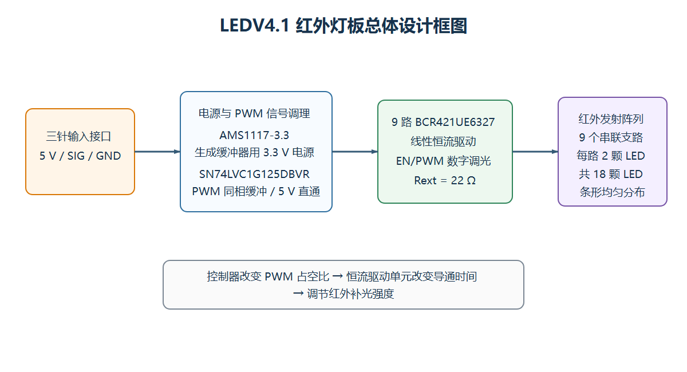
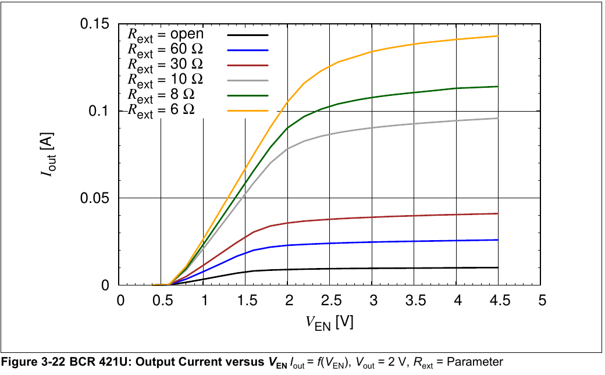
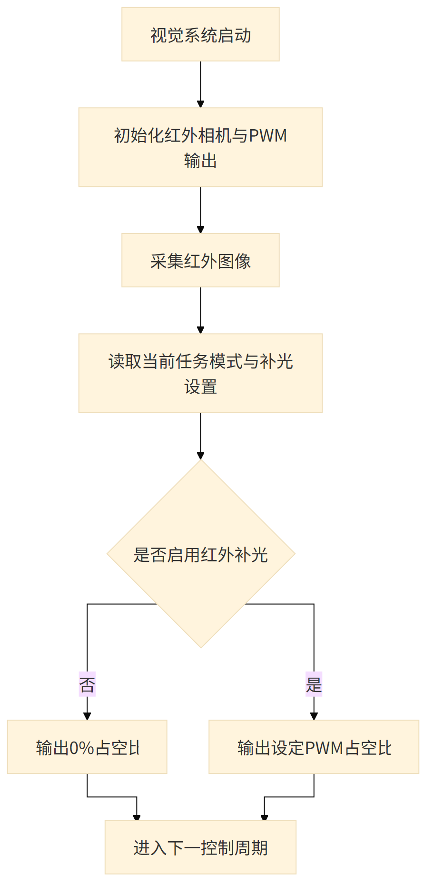
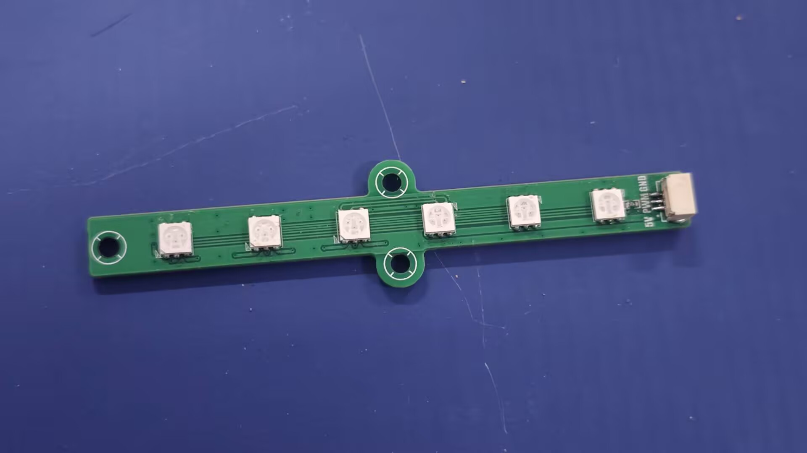
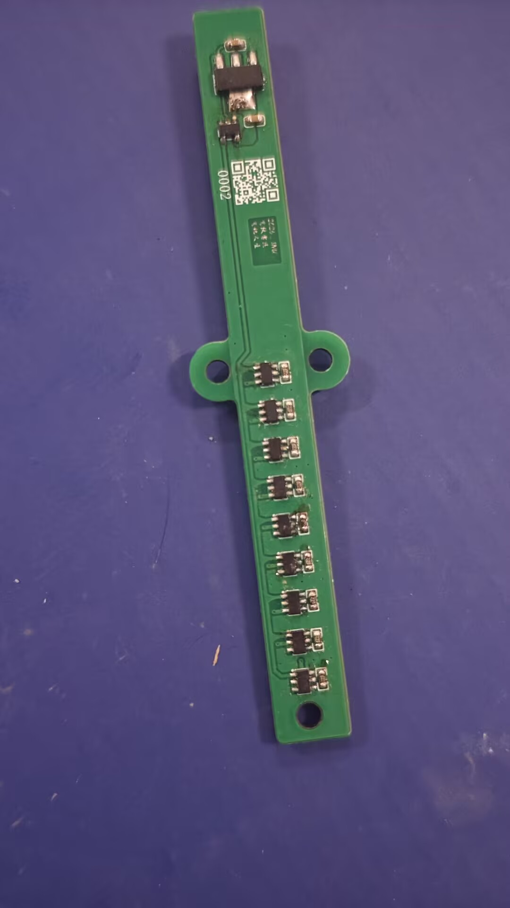

# 21届智能车_飞跃雷区_LEDV4.1红外灯板

> 江南大学｜博世·飞驰人生队｜第21届全国大学生智能汽车竞赛“飞跃雷区”组

## 一、基础信息

### 1.1 团队介绍

| 项目 | 内容 |
| --- | --- |
| 学校 | 江南大学 |
| 队伍 | 博世·飞驰人生队 |
| 指导教师 | 吴定会、王建华 |
| 组别 | 飞跃雷区 |
| 参赛成员及分工 | 田进：控制、机械 何昱岷：控制、视觉 玄嘉澍：控制、视觉 谢欣冉：硬件 叶泽华：硬件、机械 |
| 团队经历与成绩 | 田进获第20届智能车竞赛全国二等奖，并担任 RoboMaster（RM）团队核心成员；其余成员均为首次参加智能车竞赛。团队在本届校赛中取得优异成绩，最终获华东赛区飞跃雷区组第五名、一等奖（以现有比赛成绩及获奖截图为依据） |

团队围绕无人机与地面小车协同系统完成控制、感知、动力和机械结构设计。LEDV4.1 由队伍自主完成原理图、PCB、装配和成像验证。

### 1.2 题目要求

比赛场地为边长约 **5 m～7 m** 的平整区域，同一时刻可能有 **1～5 个**红光/红外信标点亮。比赛前可遥控悬停飞机起飞；飞机稳定悬停并示意发车后，第一个信标点亮并开始计时，此后选手不得再操作遥控器。机载摄像头和环境传感器识别信标并通过有线通信引导车模，车模驶过灯罩使信标熄灭，最后一个信标熄灭后停止计时，再由选手手动降落飞机。

车模与飞机通过不超过 **1.5 m** 的线缆供电和传输数据，两者之间禁止无线通信；信标感知设备必须安装在飞机上。车模及附属物应能放入 **30 cm×30 cm** 方框且高度小于 **30 cm**；飞机连同螺旋桨和保护罩应能放入 **50 cm×50 cm** 方框，最高点距地面不超过 **1.5 m**。目标搜索、图像处理和车模控制使用 **TRAVEO** 系列任务芯片；飞控、电调及关键电源/驱动电路需要自行设计，螺旋桨必须安装全包围保护罩。

> 规则依据：[车模与场地说明](https://blog.csdn.net/zhuoqingjoking97298/article/details/154691546)、[飞跃雷区问答](https://blog.csdn.net/zhuoqingjoking97298/article/details/157686655)。最终以现场组委会公布和检查结果为准。

## 二、设计概述

### 2.1 项目介绍

LEDV4.1 是面向红外相机补光的条形灯板。为直接适配现有小车主板，灯板采用 5 V 供电，并使用 AMS1117-3.3 生成逻辑电源。18 颗红外 LED 组成 9 个两灯串联支路，每个支路由一颗英飞凌 **BCR421UE6327** 线性恒流驱动器控制。CYT4BB7 输出的 SIG/PWM 先经过 **SN74LVC1G125DBVR** 三态缓冲器，再同步送至 9 路驱动器的 EN 端，使飞控能够通过占空比调节整体补光强度，并将后级多路输入负载与主控 GPIO 隔离。

## 三、核心设计

### 3.1 总体设计框图

5 V 为 LED 驱动和稳压器供电，AMS1117-3.3 为 SN74LVC1G125DBVR 提供 3.3 V。CYT4BB7 输出的 SIG/PWM 经缓冲后同时控制 9 路 BCR421UE6327 恒流驱动单元，最终驱动由 18 颗红外 LED 组成的发射阵列。

### 3.2 硬件电路组成

#### 3.2.1 输入与逻辑电源

三针接口引出 5 V、SIG 和 GND。5 V 经 AMS1117-3.3 生成 3.3 V，为 SN74LVC1G125DBVR 供电。该器件是单路同相总线缓冲器，带低有效三态使能端：**OE 为低电平时，Y 跟随 A；OE 为高电平时，Y 为高阻态**。本板将 OE 接地，使缓冲器始终使能；CYT4BB7 的 SIG 接 A，Y 输出为驱动灯板的 PWM。

根据 TI 数据手册，SN74LVC1G125 的推荐供电范围为 **1.65～5.5 V**，输入可承受 **5.5 V**，在 3.3 V 供电时具有 **±24 mA** 的额定输出驱动能力。加入该器件后，CYT4BB7 只需驱动一个逻辑输入，由缓冲器承担 9 颗 BCR421UE6327 EN 输入的扇出及开关瞬态负载，同时改善 PWM 边沿并隔离主控与灯板负载。

#### 3.2.2 红外 LED 与驱动

红外 LED 阵列由 5 V 母线供电，18 颗 LED 组成 9 个两灯串联支路。BCR421U 是用于低、中功率 LED 的低端线性恒流驱动器，具备数字调光 EN 输入；基础输出电流为 10 mA，可通过 Rext 外接电阻提高设定电流，器件最大输出能力为 **150 mA**。本板每路 Rext 配置 22 Ω，9 颗 BCR421UE6327 的 EN 端由同一路缓冲后 PWM 控制，从而实现各支路同步开关和整板亮度调节。实际支路电流仍应通过波形、电流及温升测试确认。

英飞凌给出的工作电压范围为 **1.4～40 V**，典型压差约 **0.95 V**。设计 LED 串联数量时，应满足“供电电压大于串联 LED 总正向压降与驱动器压差之和”。BCR421U 属于线性驱动器，其损耗近似为驱动器两端压降与 LED 电流的乘积；因此改用 12 V 或更高电压时，应增加每个支路的串联 LED 数量，不能只提高供电电压。

图3摘自英飞凌 BCR420U/BCR421U 数据手册 Rev. 2.2 的 Figure 3-22，测试条件为 **Vout = 2 V**。曲线表明，当 EN 高电平进入稳定区后，减小 Rext 会提高单路导通电流上限，增大 Rext 则会降低电流。本板采用 **3.3 V EN** 和 **22 Ω Rext**，其趋势位于图中的 30 Ω 与 10 Ω 曲线之间；由于图中未给出 22 Ω 曲线，不能通过插值将读图结果作为保证值。复刻时若需调整上限电流，应同时参考数据手册 Figure 3-15 的 `Iout-Rext` 曲线选择电阻，再实测支路电流和温升，并确保连续输出电流不超过手册规定的 150 mA。Rext 调整的是 LED 导通时的电流上限，PWM 占空比调节的是周期平均亮度，两者不能相互替代。

本灯板未使用可编程器件或成品开源板；控制 PWM 由飞控输出。

器件资料：[Infineon BCR420U/BCR421U 数据手册](https://www.infineon.com/assets/row/public/documents/24/49/infineon-bcr420u-bcr421u-datasheet-en.pdf)、[TI SN74LVC1G125 数据手册](https://www.ti.com/lit/ds/symlink/sn74lvc1g125.pdf)。

### 3.3 项目功能与参数

核心功能：

- 为红外相机和视觉识别系统提供主动红外照明。
- 接收单路控制信号并进行逻辑缓冲整形。
- 通过 PWM 占空比调节整体发光强度。
- 多组 LED 沿长条形 PCB 分布，提高照明覆盖范围。

关键参数：

| 参数 | 设计值/说明 |
| --- | --- |
| 输入电源 | 5 V |
| 逻辑电源 | AMS1117-3.3 生成 3.3 V |
| 控制输入 | 1 路 SIG/PWM |
| PWM 缓冲器 | SN74LVC1G125DBVR；3.3 V 供电，OE 接地常使能，额定输出驱动能力 ±24 mA |
| 发光器件 | 6 组×3 颗，共 18 颗红外 LED |
| LED 连接方式 | 9 个支路，每支路 2 颗 LED 串联 |
| 恒流驱动 | 9×BCR421UE6327；Rext 为 22 Ω，支持 EN/PWM 数字调光 |
| BCR421U 手册范围 | 工作电压 1.4～40 V，最大输出 150 mA，典型压差约 0.95 V |
| PCB 层数 | 2 层 |
| 测试数据说明 | 尚未形成红外波长、整板额定电流/功耗及推荐 PWM 频率的完整测试数据，因此不作为公开额定参数 |

### 3.4 程序设计流程图

#### 程序构成说明

灯板自身不含 MCU 和独立固件，因此没有单独的主程序。控制逻辑运行在飞控 CYT4BB7 中，灯板只接收飞控输出的 PWM 信号并完成缓冲和恒流驱动。

#### PWM 补光控制流程

#### 源代码与开源来源

PWM 由飞控工程配置和输出，经 SN74LVC1G125DBVR 缓冲后送入各路 BCR421UE6327 的使能端。无人机飞控、视觉代码及上位机源码见[无人机软件仓库](https://github.com/kross903/Seekfree_CYT4BB_Opensource_Library)。飞控底层平台参考逐飞科技 [CYT4BB7 Library](https://gitee.com/seekfree/CYT4BB7_Library)；复刻和再发布相关软件时，应保留来源说明并遵循原项目页面公布的开源许可要求。

## 四、作品展示

### 4.1 实物展示

图4：LED V4.1 红外灯板正面整体实物，展示 18 颗红外 LED 的排列方式。

图5：灯板背面 BCR421UE6327 恒流驱动器及 SN74LVC1G125DBVR 缓冲电路特写。

图6：LED V4.1 安装到整机结构后的工作状态。

### 4.2 演示视频

视频附件：[LED V4.1 红外灯板演示视频](./灯板展示.mp4)

- 视频时长：约 12 秒。
- 核心内容：红外灯板实物及点亮工作状态展示。
- 视频文件约 14.6 MiB，可直接作为开源报告附件上传。

## 五、补充说明

### 5.1 注意事项

- 红外光肉眼不易察觉，不能以“看起来不亮”判断断电，避免近距离长时间直视。
- 首次上电使用限流电源，先检查 3.3 V 和 PWM 波形，再提高占空比。
- 高占空比运行会产生热量，应进行连续点亮温升测试并保证通风。
- 接线前确认 5 V、SIG、GND 顺序，反接或信号过压可能损坏器件。
- 成像过曝时应降低占空比，或调整灯板与相机的相对位置和角度。
- 本版 5 V 方案用于直接兼容现有小车主板。若改用 12 V 或更高供电并增加单支路串联 LED 数量，必须重新核算 BCR421UE6327 的压差、芯片功耗、设定电流和整板温升，不能直接替换电源。
- 推荐装配顺序：阻容/逻辑器件→LED→连接器→短路检查→低占空比点亮→成像与温升测试。

### 5.2 附件内容

| 附件 | 文件名 | 内容 | 开源链接 |
| --- | --- | --- | --- |
| 附件一 | `2026_JNU_飞驰人生_红外灯板_2026-07-12.zip` | Gerber、钻孔及生产文件 | [下载生产文件](./2026_JNU_飞驰人生_红外灯板_2026-07-12.zip) |
| 附件二 | `灯板展示.mp4` | 红外灯板实物及点亮工作状态演示 | [查看演示视频](./灯板展示.mp4) |
