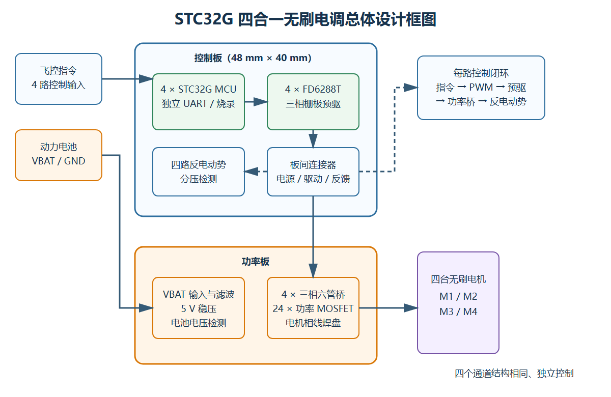
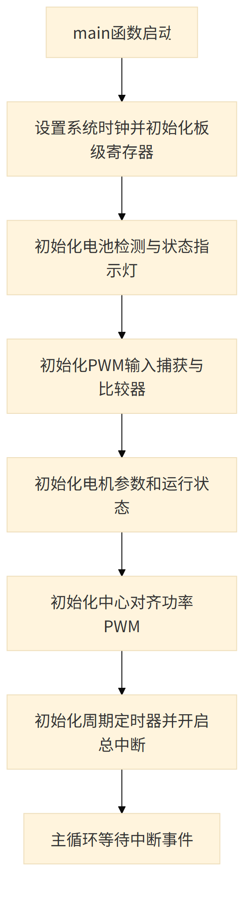
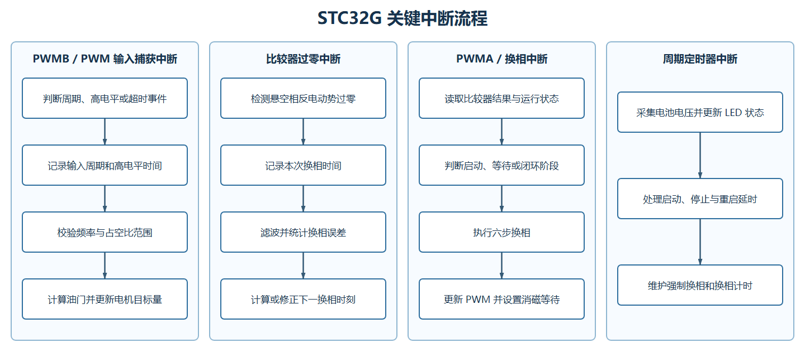
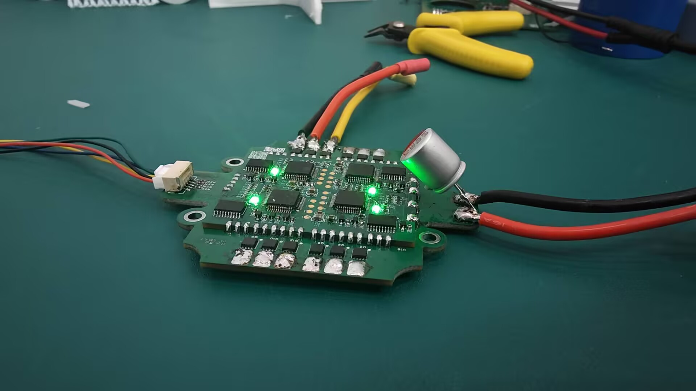
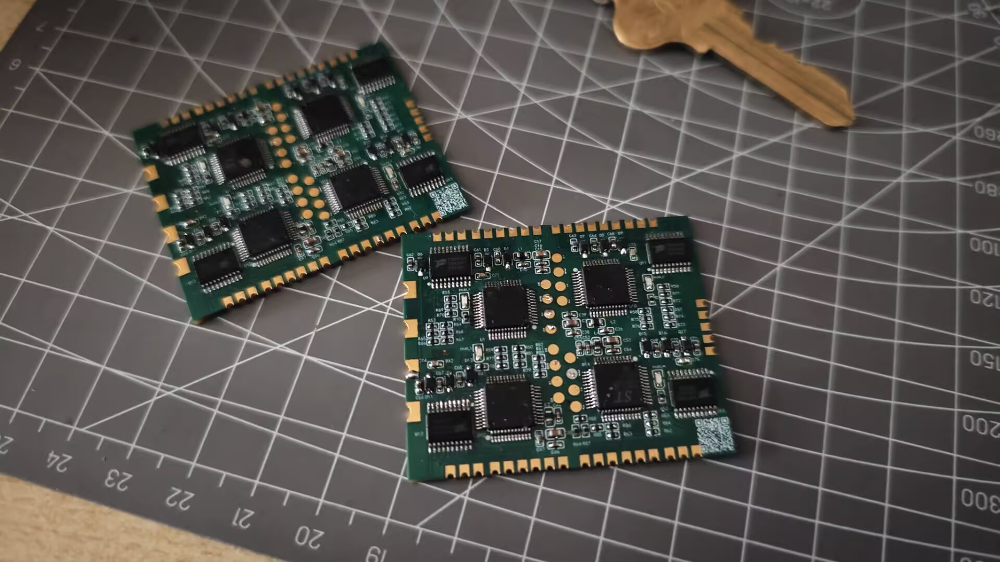
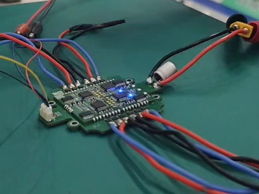

# 21届智能车_飞跃雷区_STC32G四合一无刷电调

> 江南大学｜博世·飞驰人生队｜第21届全国大学生智能汽车竞赛“飞跃雷区”组

## 一、基础信息

### 1.1 团队介绍

| 项目 | 内容 |
| --- | --- |
| 学校 | 江南大学 |
| 队伍 | 博世·飞驰人生队 |
| 指导教师 | 吴定会、王建华 |
| 组别 | 飞跃雷区 |
| 参赛成员及分工 | 田进：控制、机械<br>何昱岷：控制、视觉<br>玄嘉澍：控制、视觉<br>谢欣冉：硬件<br>叶泽华：硬件、机械 |
| 团队经历与成绩 | 田进获第20届智能车竞赛全国二等奖，并担任 RoboMaster（RM）团队核心成员；其余成员均为首次参加智能车竞赛。团队在本届校赛中取得优异成绩，最终获华东赛区飞跃雷区组第五名、一等奖（以现有比赛成绩及获奖截图为依据） |

团队围绕无人机与地面小车协同系统完成控制、感知、动力和机械结构设计。本工程由队伍完成单路方案的四路化、控制/功率分板、接口适配、PCB 设计和整机验证。

### 1.2 题目要求

比赛场地为边长约 **5 m～7 m** 的平整区域，同一时刻可能有 **1～5 个**红光/红外信标点亮。比赛前可遥控悬停飞机起飞；飞机稳定悬停并示意发车后，第一个信标点亮并开始计时，此后选手不得再操作遥控器。机载摄像头和环境传感器识别信标并通过有线通信引导车模，车模驶过灯罩使信标熄灭，最后一个信标熄灭后停止计时，再由选手手动降落飞机。

车模与飞机通过不超过 **1.5 m** 的线缆供电和传输数据，两者之间禁止无线通信；信标感知设备必须安装在飞机上。车模及附属物应能放入 **30 cm×30 cm** 方框且高度小于 **30 cm**；飞机连同螺旋桨和保护罩应能放入 **50 cm×50 cm** 方框，最高点距地面不超过 **1.5 m**。目标搜索、图像处理和车模控制使用 **TRAVEO** 系列任务芯片；飞控、电调及关键电源/驱动电路需要自行设计，螺旋桨必须安装全包围保护罩。

> 规则依据：[车模与场地说明](https://blog.csdn.net/zhuoqingjoking97298/article/details/154691546)、[飞跃雷区问答](https://blog.csdn.net/zhuoqingjoking97298/article/details/157686655)。最终以现场组委会公布和检查结果为准。

## 二、设计概述

### 2.1 项目介绍

本项目是一套控制板与功率板上下叠装的四合一无刷电调。控制板布置四颗 STC32G 系列 MCU，每颗 MCU 独立负责一路电机，并配置 FD6288T 三相栅极预驱器、反电动势检测和独立串口/烧录接口；功率板集成四组三相 MOSFET 功率桥、电池输入滤波、5 V 稳压、电压检测与控制信号接口。两板通过板间连接器传递电源、驱动和检测信号。分板结构便于控制与功率部分独立验证，也利于维护和版本迭代。

## 三、核心设计

### 3.1 总体设计框图



飞控的四路指令分别进入四颗 STC32G MCU。每颗 MCU 控制一颗 FD6288T 和一组三相六管桥，并读取本通道三相反电动势。动力电池、5 V 电源和功率 MOSFET 位于功率板，两板由板间连接器互联。

### 3.2 硬件电路组成

#### 3.2.1 开源参考与四路化设计

本工程以逐飞科技开源的 [STC32G12K128 单路无感无刷电调工程](https://gitee.com/seekfree/STC32G12K128_BLDC_Project) 为基础。逐飞方案提供了单路 STC32G 控制、FD6288T 三相预驱和反电动势检测的参考；队伍在此基础上扩展为四个相互独立的电机通道，并重新设计 48 mm×40 mm 控制板、24 管功率板、板间连接器、公共电源与电池检测网络，形成控制板和功率板上下叠装的四合一结构。

四路化并非简单复制接口：队伍需要完成四颗 MCU 与四路预驱的资源规划、四组三相功率回路的布局、公共供电及检测设计，并处理四路同时工作时的电流、散热和开关干扰问题。参考工程及来源已在上文列明，复刻、修改和再发布时应同时保留该来源说明，并遵循原项目页面公布的开源许可要求。

#### 3.2.2 控制板与板间接口

控制板尺寸约 48 mm×40 mm。板间接口传递四组三相高低边驱动、三相反电动势反馈、5 V、预驱电源、VBAT 检测及地。叠板时必须核对 1 脚和电源方向，避免错位造成大面积器件损坏。


#### 3.2.3 四路独立控制与预驱

四个通道采用相同结构，每路由一颗 STC32G 系列 MCU、一颗 FD6288T 三相预驱、三相反电动势分压网络、5 V 指示及串口/烧录接口组成。MCU 输出互补 PWM，经预驱器转换为高、低边栅极信号。


#### 3.2.4 功率板电源与检测

功率板使用两组 VBAT/GND 焊盘接入电池，多颗 22 μF 电容并联完成母线去耦。板上稳压电路生成 5 V，电池电压经分压输出至 ADC。功率板同时提供外部控制信号连接器。当前版本的控制供电链路不适合直接接入高于 12 V 的电源；若动力电池电压高于 12 V，需要增加一级 DCDC，将电压降至 12 V 及以下后再送入控制部分的板载降压模块。


#### 3.2.5 三相 MOSFET 功率桥

每路功率级由三个半桥组成，共六颗 TPN2R703NL 功率 MOSFET；四路共 24 颗。三相中点连接电机焊盘，并回传相电压至控制板用于无位置传感器换相。


本工程未直接使用成品电调板，属于在逐飞单路开源方案基础上的四路化硬件设计。固件直接采用逐飞开源的 STC32G12K128 单路无感无刷工程，来源和烧录方式见 3.4 节；复刻和再发布时应遵循原项目公布的开源许可要求。

### 3.3 项目功能与参数

核心功能：

- 四颗 MCU 分别控制四台无刷电机，降低通道间软件耦合。
- 每路提供三相栅极预驱、六管功率桥和反电动势检测。
- 提供四路外部控制输入和每路独立串口/烧录接口。
- 功率板集中完成电池接入、母线滤波、5 V 供电和电池电压采样。
- 控制板与功率板可分别调试和更换。

关键参数：

| 参数 | 设计值/说明 |
| --- | --- |
| 系统结构 | 控制板+功率板叠层 |
| 控制器 | 4×STC32G 系列 MCU |
| 栅极预驱 | 4×FD6288T |
| 功率桥 | 4×六管桥，共 24 颗 TPN2R703NL |
| 位置反馈 | 每路三相反电动势分压检测 |
| 调试接口 | 每路独立 UART/烧录接口 |
| 控制板尺寸 | 48 mm×40 mm |
| 功率板层数 | 4 层（Gerber 含 2 个内层） |
| 输入电压 | 当前版本不高于 12 V；更高电压使用时需为控制供电增加前级 DCDC |
| 输出能力说明 | 未进行四路同时带载的额定能力测试，因此不公布持续/峰值电流额定参数 |

### 3.4 程序设计流程图

四颗 MCU 均运行相同的单通道固件，每颗 MCU 独立接收对应通道的控制输入并驱动一路电机。根据逐飞开源工程的 `main.c` 和工程内附《STC 电调程序流程图》，主程序完成初始化后进入空循环，输入捕获、无感过零检测、换相和状态管理主要由中断完成。

#### 主程序初始化流程



逐飞源码特别注明：**功率 PWM 初始化必须放在电机参数初始化之后**，否则可能导致电机或功率级异常。

#### 关键中断流程



以上流程是对逐飞官方完整流程图的精简，保留了本工程复刻和排错所需的初始化顺序、输入捕获、反电动势过零、六步换相及定时状态管理关系。

#### 源代码功能与开源来源

逐飞单通道固件的 `main()` 按固定顺序初始化检测、输入、比较器和电机控制模块，随后由中断驱动实际控制流程。关键初始化顺序如下：

```c
battery_init();
led_init();
pwm_input_init();
comparator_init();
motor_init();
pwm_out_init();
pit_timer_init();
EnableGlobalIRQ();

while(1)
{
}
```

四颗 STC32G 均分别烧录逐飞科技开源的 [STC32G12K128 单路无感无刷电调工程](https://gitee.com/seekfree/STC32G12K128_BLDC_Project) 固件，不需要额外编写四路集中控制程序。每颗 MCU 烧录时，应先在 STC 下载工具中点击下载，使下载工具进入等待状态，再将弹簧烧录针压到控制板中部与目标 MCU 对应的烧录焊盘，并保持稳定接触直至下载和校验完成。该操作顺序可能与 STC 的上电握手时序有关。固件来源为逐飞开源项目，复刻和再发布时应保留来源说明并遵循其项目页面公布的开源许可要求。

## 四、作品展示

### 4.1 实物展示



图6：STC32G 四合一电调控制板与功率板叠装整体实物。



图7：控制板模块特写，可见四颗 STC32G、预驱器及中部烧录焊盘。



图8：四路电机接线后的通电运行状态。

图6至图8展示了板卡整体、控制模块和工作状态。板上四颗 STC32G 分别负责一路无感无刷电机控制，板中部的测试焊盘用于四颗 MCU 的分路烧录与调试。

### 4.2 演示视频

视频附件：[STC32G 四合一电调演示视频](./stc32g演示视频.mp4)

- 视频时长：约 49 秒。
- 核心内容：STC32G 四合一电调实物及运行状态演示。
- 视频文件约 15 MB，可直接作为开源报告附件上传。

## 五、补充说明

### 5.1 注意事项

- 控制板与功率板必须按 1 脚、VBAT、5 V、GND 和相线标识核对方向，严禁错位叠装。
- 先分板验证电源和 MCU，再叠板测试，不要在未知短路状态下接动力电池。
- 首次驱动使用低压限流电源和示波器检查互补 PWM、死区及栅极波形。
- 当前版本不得将高于 12 V 的电源直接接入控制供电链路。使用更高电压的动力电池时，应增加一级 DCDC，将输出降至 12 V 及以下后再接入控制部分的板载降压模块；同时还需重新核对 MOSFET、母线电容、FD6288T、电压采样网络等器件和电路的耐压余量。
- 反电动势采样靠近高 dv/dt 节点，采样时刻、软件滤波和接地会影响换相稳定性。
- 24 颗 MOSFET 的安全电流必须通过四路同时带载温升测试确定。
- 推荐装配顺序：控制板小器件→四路烧录测试→功率板小器件/MOSFET→桥臂短路检查→限流叠板→逐路电机测试。

#### 常见问题排查

1. 两块板上的元器件较多且间距紧凑，焊锡碎屑或多股导线脱落的细金属丝落入器件间隙后容易造成短路。每次焊接、返修和叠板前均应在断电并确认母线电容完成放电的情况下，使用放大镜检查和清洁 PCB，再进行限流上电。
2. 功率 MOSFET 烧毁时，所连接的栅极预驱器往往也可能损坏，维修时不能只更换 MOSFET，还应检查对应 FD6288T 的供电和输出。STC32G 不直接驱动 MOSFET 栅极，预驱级能够起到一定的缓冲保护作用，因此 MCU 通常不会同时损坏；但重新上电前仍需检查对应 MCU 的电源和控制引脚是否异常。
3. 在供电、焊接和电机接线均确认正常的情况下，若某一路电调自检提示音异常，应优先检查该通道的 FD6288T 及自举电容。若这些部分正常，可继续检查栅极电阻和反电动势分压电阻；后两项是可参考的扩展排查方向，本队调试中暂未遇到相关故障。
4. 四颗 STC32G 需要分别烧录。正确顺序是先在 STC 下载工具中点击下载，再将弹簧烧录针压到控制板中部与目标 MCU 对应的烧录焊盘，并保持探针稳定接触直至下载及校验完成。若先接触探针再点击下载，可能因未满足上电握手时序而无法开始烧录；此时应移开探针并按上述顺序重试，同时检查烧录针接触、供电和所选通道。
5. 控制板与功率板的板间连接器以及外部信号连接器不应承受线束拉力。插拔时应握住连接器或板体，并对线束进行固定和应力释放，避免连接器、焊盘或板间插针受损。

### 5.2 附件内容

| 附件 | 文件名 | 内容 | 开源链接 |
| --- | --- | --- | --- |
| 附件一 | `功率板/底板.zip` | 功率板 Gerber 与钻孔文件 | [下载功率板生产文件](./功率板/底板.zip) |
| 附件二 | `stc32g演示视频.mp4` | 四合一电调实物及运行状态演示 | [查看演示视频](./stc32g演示视频.mp4) |
| 附件三 | 逐飞 STC32G12K128 单路无感无刷固件 | 四颗 MCU 均分别烧录该开源工程固件 | [STC32G12K128_BLDC_Project](https://gitee.com/seekfree/STC32G12K128_BLDC_Project) |
