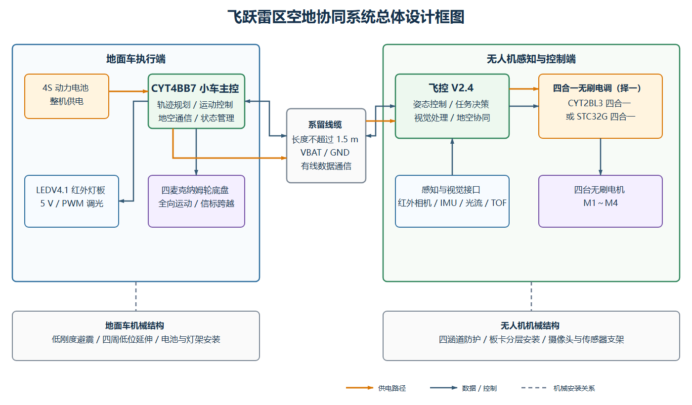
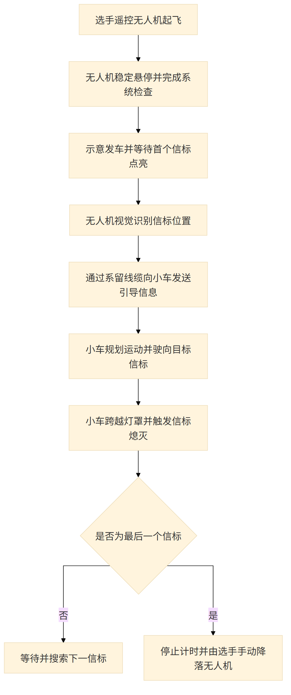
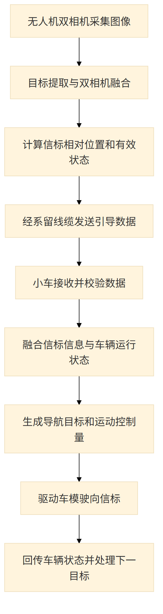
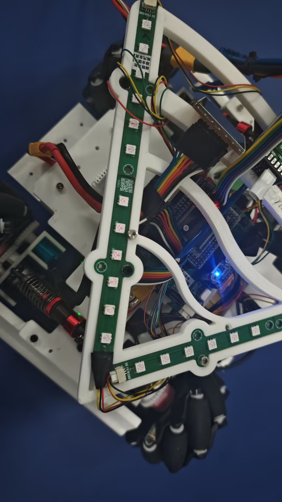

# 21届智能车_飞跃雷区_无人机与地面车空地协同系统

> 江南大学｜博世·飞驰人生队｜第21届全国大学生智能汽车竞赛“飞跃雷区”组

## 一、基础信息

### 1.1 团队介绍

| 项目 | 内容 |
| --- | --- |
| 学校 | 江南大学 |
| 队伍 | 博世·飞驰人生队 |
| 指导教师 | 吴定会、王建华 |
| 组别 | 飞跃雷区 |
| 参赛成员及分工 | 田进：控制、机械<br>何昱岷：控制、视觉<br>玄嘉澍：控制、视觉<br>谢欣冉：硬件<br>叶泽华：硬件、机械 |
| 团队经历与成绩 | 田进获第20届智能车竞赛全国二等奖，并担任 RoboMaster 团队核心成员；其余成员均为首次参加智能车竞赛。团队在本届校赛中取得优异成绩，最终获华东赛区飞跃雷区组第五名、一等奖。 |

团队围绕无人机与地面小车协同系统完成控制、视觉、硬件和机械结构设计，并对飞控、电调、红外灯板、车体及无人机结构进行装配调试和整机验证。

### 1.2 题目要求

比赛场地为边长约 **5 m～7 m** 的平整区域，同一时刻可能有 **1～5 个**红光/红外信标点亮。比赛前可遥控悬停飞机起飞；飞机稳定悬停并示意发车后，第一个信标点亮并开始计时，此后选手不得再操作遥控器。机载摄像头和环境传感器识别信标并通过有线通信引导车模，车模驶过灯罩使信标熄灭，最后一个信标熄灭后停止计时，再由选手手动降落飞机。

车模与飞机通过不超过 **1.5 m** 的线缆供电和传输数据，两者之间禁止无线通信；信标感知设备必须安装在飞机上。车模及附属物应能放入 **30 cm×30 cm** 方框且高度小于 **30 cm**；飞机连同螺旋桨和保护罩应能放入 **50 cm×50 cm** 方框，最高点距地面不超过 **1.5 m**。目标搜索、图像处理和车模控制使用 **TRAVEO** 系列任务芯片；飞控、电调及关键电源/驱动电路需要自行设计，螺旋桨必须安装全包围保护罩。

> 规则依据：[车模与场地说明](https://blog.csdn.net/zhuoqingjoking97298/article/details/154691546)、[飞跃雷区问答](https://blog.csdn.net/zhuoqingjoking97298/article/details/157686655)。最终以现场组委会公布和检查结果为准。

## 二、设计概述

### 2.1 项目介绍

本项目是一套用于“飞跃雷区”赛题的无人机与地面车空地协同系统。无人机端以 CYT4B 系列核心板完成姿态控制、视觉感知和任务决策，通过系留线缆向小车发送信标引导信息；地面车完成路径跟踪、信标跨越和触发熄灯。本次汇总的硬件子工程包括飞控 V2.4、两种可选的四合一无刷电调方案及 LEDV4.1 红外灯板；整车还包含小车主控、驱动等板卡。软件包含无人机控制、视觉识别、离线上位机和小车控制程序。机械部分包括四涵道无人机防护结构、传感器支架、麦克纳姆轮底盘、低刚度避震及信标跨越结构。

## 三、核心设计

### 3.1 总体设计框图



橙色线路表示供电路径，蓝色线路表示数据或控制关系，灰色虚线表示机械安装关系。4S 动力电池由小车主板接口经系留线缆接入飞控 V2.4，四合一电调再从飞控板取电。CYT2BL3 与 STC32G 四合一电调是两套可选实现，整机复刻时应根据硬件版本选择其中一套，不应同时接入。

### 3.2 硬件电路组成

| 子项目 | 核心作用 | 开源入口 |
| --- | --- | --- |
| 飞控 V2.4 | 电源管理、姿态与任务控制、视觉和传感器接口、地空通信及电调控制 | [飞控 V2.4 开源工程][flight-project] |
| CYT2BL3 四合一无刷电调 | 单颗 CYT2BL3 统一接收四路目标量，驱动四组三相功率桥；比赛实际使用串口控制 | [CYT2BL3 四合一电调开源工程][cyt2-project] |
| STC32G 四合一无刷电调 | 四颗 STC32G 分别运行逐飞单路固件，通过控制板与功率板叠装形成四路驱动 | [STC32G 四合一电调开源工程][stc-project] |
| LEDV4.1 红外灯板 | 5 V 供电，18 颗红外 LED 组成 9 路恒流支路，支持 PWM 亮度控制 | [LEDV4.1 红外灯板开源工程][led-project] |

四个子工程均单独提供总体框图、原理图分析、功能参数、程序流程、实物展示、注意事项和附件说明。逐飞开源硬件及固件的引用关系、队伍修改范围和复刻要求在对应子工程中分别说明。

#### 3.2.1 机械结构

无人机采用四涵道四旋翼构型，涵道上下设置防护网，飞控、电调和传感器围绕中心区域分层安装。双摄像头使用共用刚性支架，安装方向结合实际视场进行调整。地面车采用四麦克纳姆轮底盘，通过低刚度避震提高轮组跨越信标时的贴地性，并在车体四周设置低位延伸结构以提高信标触发可靠性。

[下载无人机与地面车机械结构文件](./机械.zip)

### 3.3 项目功能与参数

核心功能：

- 无人机自主悬停，并通过红外相机、陀螺仪、光流和 TOF 等传感器完成环境感知。
- 无人机识别信标并通过有线链路向小车发送引导信息。
- 小车完成路径跟踪、全向运动、信标跨越和触发熄灯。
- 飞控通过串口向四合一电调发送四路电机控制量，同时保留 4 路 PWM 兼容方式。
- Python 视觉离线工具调用真实固件 C 算法进行图像回放、标定和回归验证。

关键参数：

| 参数 | 设计值/说明 |
| --- | --- |
| 整机供电 | 4S 动力电池接入小车主板，再由主板接口经系留线缆向无人机供电 |
| 动力母线实测 | 整机电流达到 20 A 时未发现明显异常；更高负载尚未测试，20 A 不代表最大额定电流 |
| 地空连接 | 不超过 1.5 m 的有线供电与数据链路 |
| 无人机控制核心 | 英飞凌 CYT4B 系列核心板 |
| 电调方案 | CYT2BL3 四合一或 STC32G 四合一，按实际硬件择一使用 |
| 无人机尺寸限制 | 含桨叶保护罩可放入 50 cm×50 cm 方框，最高点距地面不超过 1.5 m |
| 车模尺寸限制 | 可放入 30 cm×30 cm 方框，高度小于 30 cm |
| 最终比赛成绩 | 华东赛区飞跃雷区组第五名、一等奖 |

### 3.4 程序设计流程图

#### 比赛任务主流程



#### 空地协同关键子模块流程



#### 源代码功能与开源来源

无人机控制核通过 `CrossCoreCamera_*`、`VehicleMarkerLocalization_*` 和 `core_link_user_*` 完成视觉结果获取、信标定位及系留通信；小车主循环持续处理通信、信标融合和导航任务：

```c
core_link_user_poll();
VOFA_Task();
BeaconFusion_Service();
BeaconNav_Service();
Main_RunDroneView();
```

无人机与小车工程均在逐飞 CYT4BB7 开源库基础上开发。本队新增和修改的主要内容包括飞行控制、双相机视觉、信标定位、地空有线通信、小车信标融合与导航及上位机功能。相关第三方来源已在各硬件子工程中分别列明；复刻、修改和再发布时，应保留原项目来源说明，并遵循对应项目页面公布的开源许可要求。

软件开发主要使用 IAR Embedded Workbench、IAR C-SPY、VOFA+ 和 Python/OpenCV。源码仓库：

- [无人机飞控、视觉代码及上位机](https://github.com/kross903/Seekfree_CYT4BB_Opensource_Library)
- [地面小车控制代码](https://github.com/saileqwq/CYT4BB7_Car)

## 四、作品展示

### 4.1 实物展示


图2：无人机整体装机与飞控通电状态，展示空中端控制系统的实际安装位置。


图3：比赛最终使用的 CYT2BL3 四合一电调装机运行状态。


图4：STC32G 四合一电调备选方案的四路接线通电运行状态。



图5：LED V4.1 红外灯板安装到整机结构后的工作状态。

### 4.2 演示视频

视频附件：[江南大学-飞跃雷区-博世·飞驰人生队演示视频](./江南大学-飞跃雷区-博世·飞驰人生队-50MB内.mp4)

- 视频时长：约 1 分 45 秒。
- 核心内容：无人机与地面小车完成“飞跃雷区”整机比赛任务。
- 视频文件约 42 MiB，可直接作为开源报告附件上传；126.6 MiB 原始视频同时保留在工程目录中。

## 五、补充说明

### 5.1 注意事项

- CYT2BL3 与 STC32G 四合一电调为两套不同方案，复刻时必须选择与对应 PCB、固件和接口匹配的一套。
- 无人机首次通电和电机测试应拆除桨叶或固定机体，使用限流电源逐级检查电源、电调和传感器。
- 系留线缆同时承担供电和数据传输，应进行应力释放，并避免进入桨叶、涵道和车轮运动范围。
- 机械结构复刻前应检查 SolidWorks 外部引用、装配配合、打印公差和紧固件规格。
- 红外相机、光流、TOF 和陀螺仪的安装方向会影响坐标系，装配后必须重新标定。
- 20 A 为已有整机测试工作点，不是最大额定电流；提高负载前必须重新核对线缆、连接器、PCB 铜厚、MOSFET 和散热余量。

### 5.2 附件内容

| 附件 | 文件名/入口 | 内容 | 开源链接 |
| --- | --- | --- | --- |
| 附件一 | `机械.zip` | 无人机和地面车 SolidWorks 装配体、零件及 STEP/IGS 等结构文件 | [下载机械结构文件](./机械.zip) |
| 附件二 | `江南大学-飞跃雷区-博世·飞驰人生队-50MB内.mp4` | 空地协同整机比赛任务演示 | [查看演示视频](./江南大学-飞跃雷区-博世·飞驰人生队-50MB内.mp4) |
| 附件三 | 无人机软件仓库 | 无人机飞控、视觉代码和离线上位机 | [Seekfree_CYT4BB_Opensource_Library](https://github.com/kross903/Seekfree_CYT4BB_Opensource_Library) |
| 附件四 | 小车软件仓库 | 地面小车控制代码 | [CYT4BB7_Car](https://github.com/saileqwq/CYT4BB7_Car) |
| 附件五 | 四个硬件子工程 | 飞控、两套四合一电调和红外灯板的详细开源报告 | [飞控][flight-project]、[CYT2BL3 电调][cyt2-project]、[STC32G 电调][stc-project]、[LEDV4.1][led-project] |

[flight-project]: https://oshwhub.com/flying-over-the-minefield-self/wu-ren-ji-zhu-ban-_jnu_-fei-yue-lei-qu
[cyt2-project]: https://oshwhub.com/flying-over-the-minefield-self/project_ojplttft
[stc-project]: https://oshwhub.com/flying-over-the-minefield-self/si-lu-dian-diao-_jnu_-fei-yue-lei-qu
[led-project]: https://oshwhub.com/flying-over-the-minefield-self/led-deng-ban
