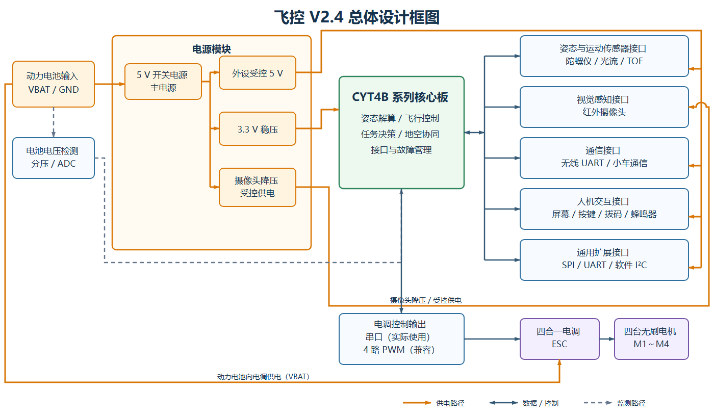
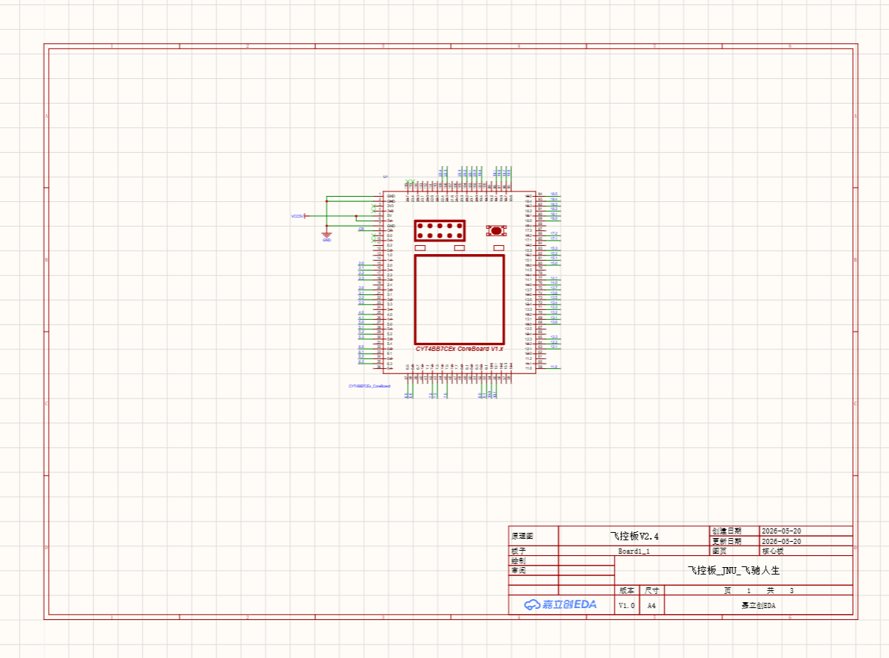
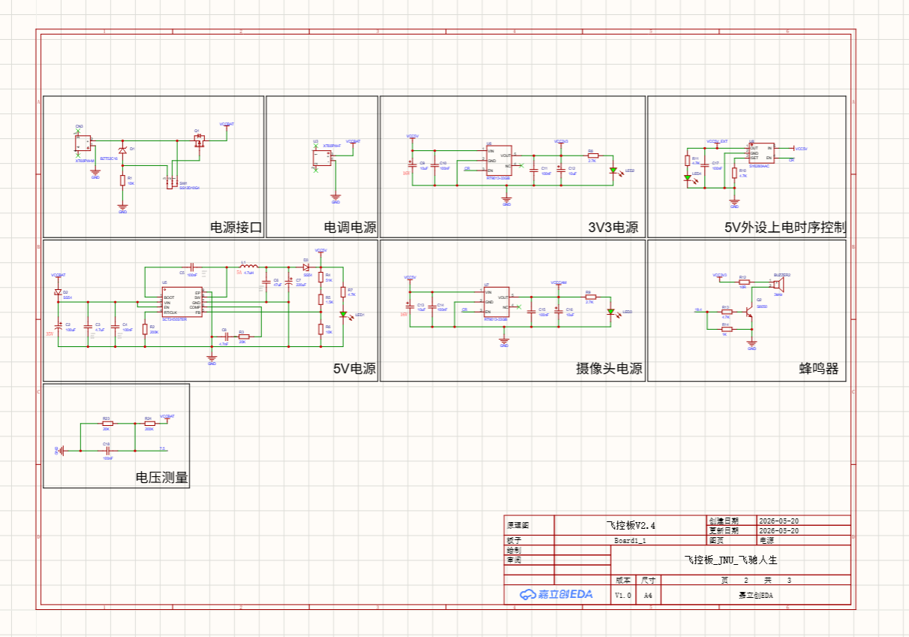
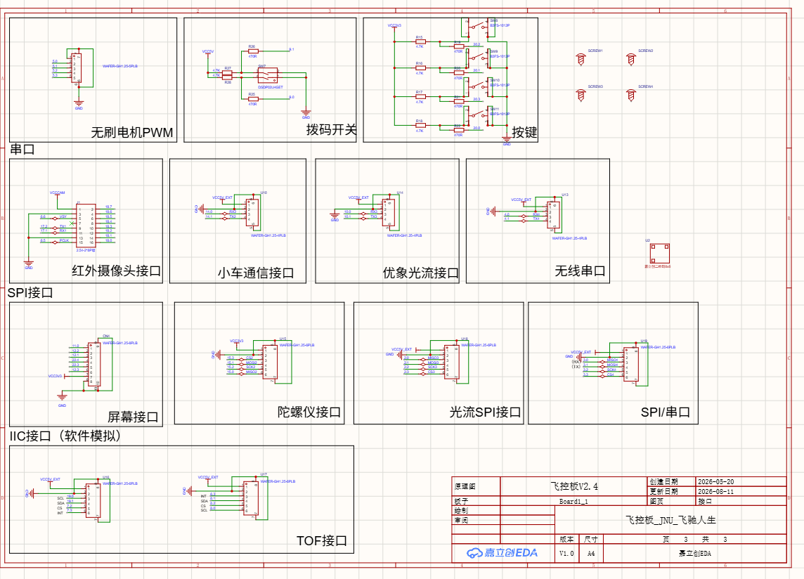
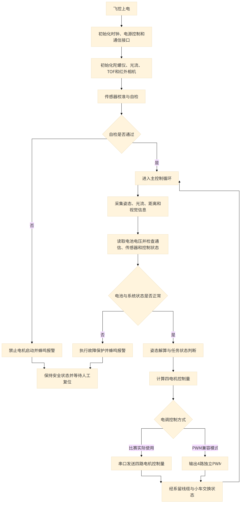
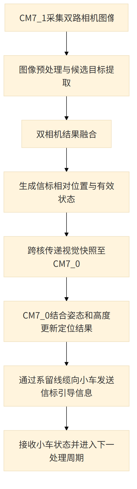
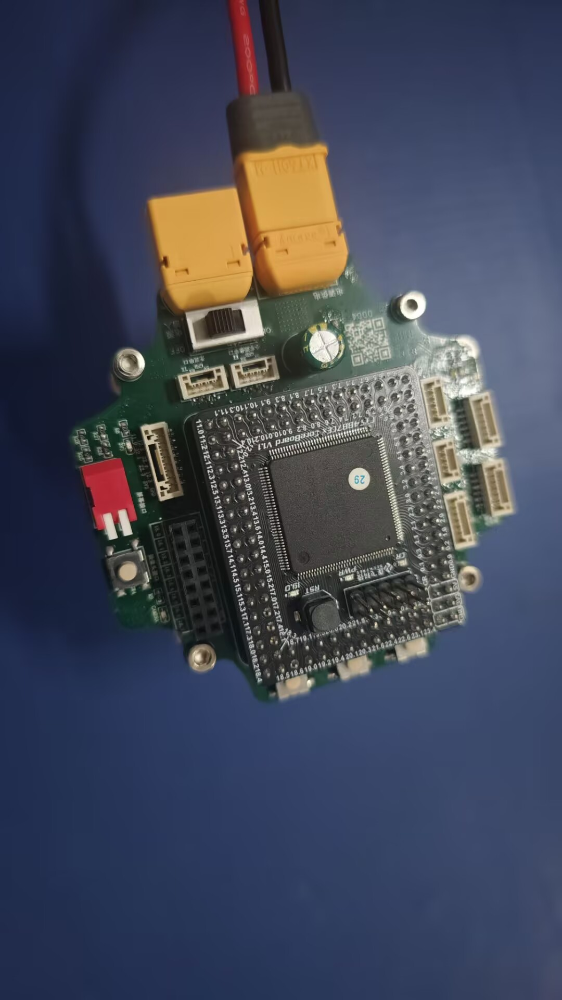
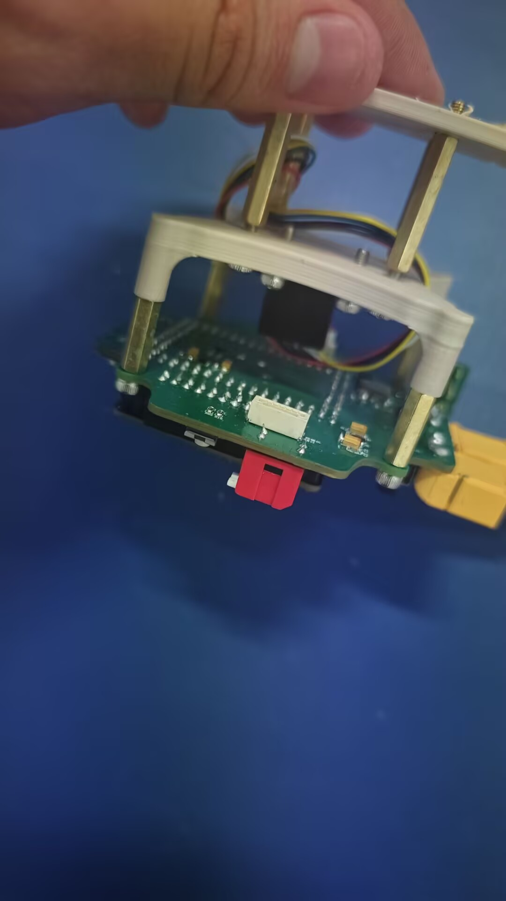
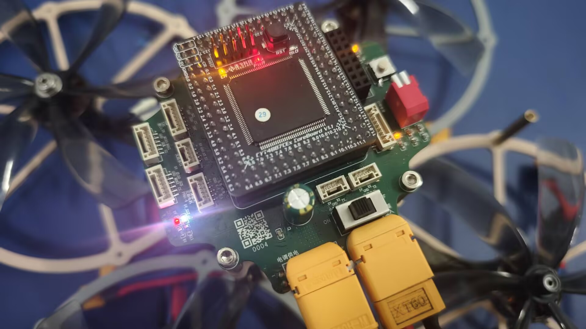

# 21届智能车_飞跃雷区_飞控V2.4

> 江南大学｜博世·飞驰人生队｜第21届全国大学生智能汽车竞赛“飞跃雷区”组

## 一、基础信息

### 1.1 团队介绍

| 项目 | 内容 |
| --- | --- |
| 学校 | 江南大学 |
| 队伍 | 博世·飞驰人生队 |
| 指导教师 | 吴定会、王建华 |
| 组别 | 飞跃雷区 |
| 参赛成员及分工 | 田进：控制、机械<br>何昱岷：控制、视觉<br>玄嘉澍：控制、视觉<br>谢欣冉：硬件<br>叶泽华：硬件、机械 |
| 团队经历与成绩 | 田进获第20届智能车竞赛全国二等奖，并担任 RoboMaster（RM）团队核心成员；其余成员均为首次参加智能车竞赛。团队在本届校赛中取得优异成绩，最终获华东赛区飞跃雷区组第五名、一等奖（以现有比赛成绩及获奖截图为依据） |

团队完成飞控硬件、嵌入式控制、机器视觉、地空通信和机械结构的协同开发。本工程由队伍完成参考方案适配、载板 PCB、接口规划、装机和整机联调。

### 1.2 题目要求

比赛场地为边长约 **5 m～7 m** 的平整区域，同一时刻可能有 **1～5 个**红光/红外信标点亮。比赛前可遥控悬停飞机起飞；飞机稳定悬停并示意发车后，第一个信标点亮并开始计时，此后选手不得再操作遥控器。机载摄像头和环境传感器识别信标并通过有线通信引导车模，车模驶过灯罩使信标熄灭，最后一个信标熄灭后停止计时，再由选手手动降落飞机。

车模与飞机通过不超过 **1.5 m** 的线缆供电和传输数据，两者之间禁止无线通信；信标感知设备必须安装在飞机上。车模及附属物应能放入 **30 cm×30 cm** 方框且高度小于 **30 cm**；飞机连同螺旋桨和保护罩应能放入 **50 cm×50 cm** 方框，最高点距地面不超过 **1.5 m**。目标搜索、图像处理和车模控制使用 **TRAVEO** 系列任务芯片；飞控、电调及关键电源/驱动电路需要自行设计，螺旋桨必须安装全包围保护罩。

> 规则依据：[车模与场地说明](https://blog.csdn.net/zhuoqingjoking97298/article/details/154691546)、[飞跃雷区问答](https://blog.csdn.net/zhuoqingjoking97298/article/details/157686655)。最终以现场组委会公布和检查结果为准。

## 二、设计概述

### 2.1 项目介绍

飞控 V2.4 是博世·飞驰人生队为“飞跃雷区”无人机设计的主控制板。该板以英飞凌 CYT4B 系列核心板为计算核心，集成动力电池接入、5 V/3.3 V 电源、摄像头与外设受控供电、电池电压检测、蜂鸣器、电调通信串口及 4 路 PWM 兼容输出，以及红外相机、陀螺仪、光流、屏幕、TOF、小车通信和无线串口等接口。载板将飞行控制、视觉感知和地空协同所需资源集中管理，减少机内线束并方便调试与维护。

## 三、核心设计

### 3.1 总体设计框图



动力电池首先经板载开关电源生成 5 V 主电源，再分为外设受控 5 V、3.3 V 稳压和摄像头降压/受控供电支路，各支路分别向核心板、传感器与外设接口以及视觉接口供电。CYT4B 系列核心板接收姿态、光流、TOF 和红外相机信息，执行飞行和任务逻辑；比赛最终通过串口向四合一电调发送四路电机控制量，同时保留 4 路 PWM 兼容输出，并通过其他串口与小车及无线模块通信。

### 3.2 硬件电路组成

#### 3.2.1 开源参考与二次设计

飞控 V2.4 的 CYT4BB7 相关设计参考了逐飞科技开源的 [CYT4BB7 Library 工程](https://gitee.com/seekfree/CYT4BB7_Library)。该工程为本项目提供 CYT4BB7 平台相关的参考资料；队伍结合“飞跃雷区”的红外相机、光流、TOF、陀螺仪、四电机 PWM 和有线小车通信需求，对接口分配、多路电源、摄像头供电、外设上电时序、电池检测和机械安装进行了适配，并完成飞控载板 PCB 与整机联调。

本工程属于面向具体参赛系统的二次设计。参考工程及来源已在上文列明；本队的接口、电源、外设和机械适配范围也已作出说明。复刻、修改和再发布时应同时保留逐飞来源说明，并遵循原项目页面公布的开源许可要求。

#### 3.2.2 主控核心板

核心板通过排针/焊盘引出 GPIO、ADC、PWM、SPI 和 UART 等资源，载板将其分配给电机控制、传感器和通信接口。CYT4BB7 平台资料来源见 3.2.1 节所列逐飞开源工程。



#### 3.2.3 电源、监测和蜂鸣器

动力电池从电源接口进入，并向电调及板载电源供电。板载开关电源首先生成 5 V 主电源，随后分出外设受控 5 V、3.3 V 稳压和摄像头降压/受控供电支路。电池电压经分压送入 ADC，蜂鸣器由三极管驱动，用于状态及故障提示。



#### 3.2.4 电机、传感器与通信接口

飞控最终通过专用串口向四合一电调传输四路电机控制量，并保留 4 路独立 PWM 兼容输出。红外相机和小车通信使用独立接口；陀螺仪、光流和屏幕使用 SPI 相关接口；TOF 采用 GPIO 软件模拟 I²C；无线模块通过 UART 通信。按键与拨码开关用于模式选择和现场调试。



#### 3.2.5 机械安装资料

工程提供 `飞控.DXF` 和 `零件1.SLDPRT`，用于核对安装孔、连接器净空和结构匹配。装机时需考虑板卡减振、线束固定、散热、重心和传感器坐标方向。

### 3.3 项目功能与参数

核心功能：

- 完成姿态解算、飞行控制和比赛任务逻辑。
- 通过串口向四合一电调发送四路电机控制量，并兼容 4 路独立 PWM 输出。
- 接入陀螺仪、光流、红外相机和 TOF 等传感器。
- 提供屏幕、无线串口和小车通信接口。
- 提供按键、拨码开关和蜂鸣器等人机交互功能。
- 生成多路机载电源并采集动力电池电压。

关键参数：

| 参数 | 设计值/说明 |
| --- | --- |
| 主控形式 | 英飞凌 CYT4B 系列核心板 |
| 电调控制 | 串口通信（最终使用），兼容 4 路独立 PWM 输出 |
| 通信接口 | 小车通信、无线 UART、通用 SPI/UART |
| 传感器接口 | 红外相机、陀螺仪、光流、TOF（软件 I²C） |
| 人机接口 | 屏幕、4 个按键、拨码开关、蜂鸣器 |
| 板载电源 | 5 V、3.3 V、摄像头电源、受控外设 5 V |
| PCB 层数 | 4 层（Gerber 含 2 个内层） |
| 机械资料 | DXF 与 SolidWorks 零件文件 |
| 动力输入 | 4S 电池 |
| 动力母线实测 | 整机电流达到 20 A 时未发现明显异常；更高负载尚未测试，20 A 仅表示已验证工作点，不代表最大额定电流 |

### 3.4 程序设计流程图

#### 飞控主程序流程



#### 双核视觉与地空通信关键流程



CM7_0 负责飞行控制、状态监测和地空有线通信，CM7_1 负责相机侧的持续处理。控制核入口位于 `project/user/main_cm7_0.c`，相机核入口位于 `project/user/main_cm7_1.c`；视觉定位、双相机融合和通信分别由 `VehicleMarkerLocalization_*`、`DualCameraFusion_BuildSnapshot()`、`CrossCoreCamera_*` 与 `core_link_user_*` 完成。

#### 源代码功能与开源来源

控制核主程序先完成通信、设备和定位模块初始化，再进入菜单及监控循环；相机核持续调用相机任务：

```c
initialize_control_core_modules();
while(true)
{
    menu_open();
    run_monitor_view_loop();
}

/* CM7_1 相机核 */
CrossCoreCamera_CameraCoreInit();
while(true)
{
    CrossCoreCamera_CameraCoreTask();
}
```

飞控底层驱动与工程框架参考逐飞科技 [CYT4BB7 Library](https://gitee.com/seekfree/CYT4BB7_Library)。本队在该平台上完成了飞行控制、双相机视觉、信标定位、系留地空通信、状态监测及上位机功能。复刻、修改或再发布时，应同时保留原项目来源说明，并遵循原项目页面公布的开源许可要求。

#### 开发环境与源码

飞控与小车的 CYT4BB7 固件主要使用 **IAR Embedded Workbench** 开发，并通过 **IAR C-SPY** 完成下载和调试；运行数据观察及参数调试使用 **VOFA+**，视觉离线工具和摄像头标定使用 **Python/OpenCV**。项目源码如下：

- [无人机飞控、视觉代码及上位机](https://github.com/kross903/Seekfree_CYT4BB_Opensource_Library)
- [地面小车控制代码](https://github.com/saileqwq/CYT4BB7_Car)

## 四、作品展示

### 4.1 实物展示



图5：飞控 V2.4 正面整体实物，可见核心板、传感器及外部接口布局。



图6：飞控 V2.4 背面、层叠安装与连接器特写，用于说明实际装配和接口位置。



图7：飞控 V2.4 安装在无人机上的通电运行状态，展示装机后的实际工作情况。

### 4.2 演示视频

视频附件：[江南大学-飞跃雷区-博世·飞驰人生队演示视频](../江南大学-飞跃雷区-博世·飞驰人生队-50MB内.mp4)

- 视频时长：约 1 分 45 秒。
- 核心内容：无人机及地面小车完成“飞跃雷区”比赛任务。
- 视频文件约 42 MiB，可直接作为开源报告附件上传。

## 五、补充说明

### 5.1 注意事项

- 接入电调、相机和传感器前核对接口电压和线序，严禁将 VBAT 接入 5 V/3.3 V 外设。
- 首次上电使用限流电源，依次测量 VBAT、5 V、3.3 V 和受控 5 V。
- 电调控制信号与传感器信号共板，应保证接地可靠并降低电调开关噪声干扰。
- **已知问题与改进建议：**<br>飞控 V2.4 的部分 GH1.25 连接器排布不利于装机后的插拔和拆装。后续版本建议重新规划连接器位置，将更多接头布置在 PCB 背面，并结合机架结构预留插拔空间；本版受比赛周期限制，未完成该项布局改进。装配时应根据 DXF 和 SolidWorks 文件重点检查孔位、连接器净空、减振及重心位置。
- 红外相机、光流、TOF 和陀螺仪安装方向会影响坐标系，装配后必须统一标定。
- 推荐调试顺序：电源→核心板下载→按键/蜂鸣器→屏幕→陀螺仪→光流/TOF→红外相机→通信→电调串口/兼容 PWM→整机飞行。

### 5.2 附件内容

| 附件 | 文件名 | 内容 | 开源链接 |
| --- | --- | --- | --- |
| 附件一 | `2026_JNU_飞驰人生_飞控V2.4.zip` | Gerber 与钻孔生产文件 | [下载生产文件](./2026_JNU_飞驰人生_飞控V2.4.zip) |
| 附件二 | `BOM_Board1_飞控板V2.2_2026-05-06.xlsx` | 现有 BOM；其版本号为 V2.2，复刻 V2.4 PCB 前应核对位号与物料 | [下载 BOM](./BOM_Board1_飞控板V2.2_2026-05-06.xlsx) |
| 附件三 | `飞控.DXF`、`零件1.SLDPRT` | 机械安装参考资料 | [下载 DXF](./飞控.DXF)、[下载 SolidWorks 零件](./零件1.SLDPRT) |
| 附件四 | `江南大学-飞跃雷区-博世·飞驰人生队-50MB内.mp4` | 整机比赛任务演示视频 | [查看演示视频](../江南大学-飞跃雷区-博世·飞驰人生队-50MB内.mp4) |
| 附件五 | 项目软件仓库 | 无人机飞控、视觉、上位机及地面小车控制代码 | [无人机仓库](https://github.com/kross903/Seekfree_CYT4BB_Opensource_Library)、[小车仓库](https://github.com/saileqwq/CYT4BB7_Car) |
| 附件六 | 逐飞 CYT4BB7 Library 参考工程 | 本工程所参考的 CYT4BB7 平台开源项目 | [CYT4BB7_Library](https://gitee.com/seekfree/CYT4BB7_Library) |
